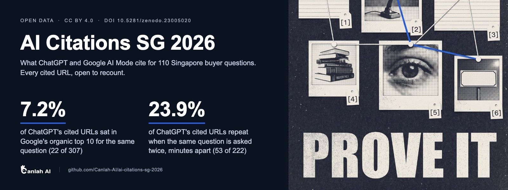

<p align="center">
  <a href="https://canlah.ai/data/ai-citations-sg-2026/?utm_source=github&utm_medium=community&utm_campaign=wk1019&utm_content=ai-citations-readme">
    
  </a>
</p>

<h3 align="center">What do ChatGPT and Google AI Mode cite when Singapore buyers ask?<br>110 questions, every cited URL, open to recount.</h3>

<p align="center">
  <a href="LICENSE"></a>
  <a href="https://doi.org/10.5281/zenodo.23005020"></a>
  <a href="https://huggingface.co/datasets/CanlahAI/ai-citations-sg-2026"></a>
  
  
  
</p>

<p align="center">
  <a href="#30-second-start"><b>Load it in 30 seconds</b></a> ·
  <a href="stats.md">Recounts and findings</a> ·
  <a href="https://github.com/Canlah-AI/geo-playbook">The playbook built on it</a> ·
  <a href="DATASHEET.zh.md">中文完整数据说明</a>
</p>

<p align="center">
  <a href="https://github.com/Canlah-AI/geo-playbook/blob/main/assets/playbook-5-moves-44s.mp4">
    
  </a>
  <br><sub>▶ <a href="https://github.com/Canlah-AI/geo-playbook/blob/main/assets/playbook-5-moves-44s.mp4">Watch the 44-second film</a></sub>
</p>

---

Put the same 60 Singapore buyer questions to ChatGPT and Google AI Mode and they cite almost entirely different pages: **19 of 507 cited URLs shared (3.7%)**. Ask ChatGPT the same question twice, minutes apart, and only 23.9% of its cited URLs come back. Here is every citation behind those numbers, so you can check them yourself.

Five Singapore industries. 110 buyer questions. ChatGPT (OpenAI API, `gpt-5.5` with web search, Singapore location) and, in round 1, Google AI Mode (through a third-party SERP API). This dataset keeps the questions, every cited URL in answer order, the ChatGPT answer texts, our page-by-page annotations of cited pages, and a catalogue of 46 cited-page types. Every headline number below can be recounted from these files; the snippet in [30-second start](#30-second-start) reproduces the first one.

## Contents

- [Key findings](#key-findings)
- [30-second start](#30-second-start)
- [What's inside](#whats-inside)
- [How it was collected](#how-it-was-collected)
- [Use it for, and not for](#use-it-for-and-not-for)
- [Cite](#cite)
- [Related](#related)

## Key findings

| # | Finding | Numbers | Detail |
|---|---|---|---|
| 1 | **Two engines, two source lists.** Asked the same questions, ChatGPT and Google AI Mode barely overlap | 19 of 507 cited URLs shared (3.7%); by registered domain 31 of 403 (7.7%). In 36 of the 54 questions both engines answered with sources, they shared no URL at all | [stats 3.1](stats.md#31-两个引擎引的来源不一样第一轮) |
| 2 | **A Google top-10 ranking is not a ChatGPT citation** | 7.2% of ChatGPT's cited URLs (22 of 307) sat in Google's organic top 10 for the same question; for AI Mode, 40.6% (89 of 219) | [stats 3.3](stats.md#33-被引的页大多不在-google-前-10) |
| 3 | **In round 1, ChatGPT cited no forum or social page** | 0 of 307 for ChatGPT; 30 of 219 for AI Mode (YouTube 13, Reddit 10). About a fifth of Google's organic top 10 for the same questions were forum or social pages (114 of 556). Round 2 ChatGPT: 3 of 241 | [stats 3.2](stats.md#32-chatgpt-几乎不引论坛社媒google-前-10-里有两成是论坛社媒) |
| 4 | **In regulated industries, ChatGPT leans public and AI Mode leans commercial** | Dental: 76% of ChatGPT's citations (38 of 50) went to government and public-institution pages, while 75% of AI Mode's (39 of 52) went to clinics and other commercial sites. Family law: 77% of ChatGPT's (46 of 60) went to .gov.sg | [stats 3.1](stats.md#31-两个引擎引的来源不一样第一轮) |
| 5 | **The question type moves the sources** | ChatGPT's share of government pages: 33% (102 of 307) for round 1's decision questions, 57% (138 of 241) for round 2's nine question types. Different question mix, same night | [stats 3.4](stats.md#34-换一种问法chatgpt-的来源就变了第二轮) |
| 6 | **One ask is a sample, not a ranking** | 30 round-2 questions asked twice, minutes apart: only 23.9% of ChatGPT's cited URLs repeated (53 of 222); 43.8% by domain. 1 of 30 came back identical | [stats 3.5](stats.md#35-同一句问句问两次引用的网址大多不一样) |

One citation means one distinct URL within one answer. Round 1 (60 questions, two engines) produced 526 citations; round 2 (50 questions, ChatGPT only) produced 241. The rounds use different questions, so their counts are reported side by side, never added.

## 30-second start

With pandas, straight from GitHub:

```python
import pandas as pd

base = "https://raw.githubusercontent.com/Canlah-AI/ai-citations-sg-2026/main/"
cit = pd.read_csv(base + "citations.csv")
official = cit[cit.official == "yes"]
print(official.groupby(["run_id", "engine"]).size())   # r1 chatgpt 307, r1 google_ai_mode 219, r2 chatgpt 241

# Finding 1: cited URLs shared by the two engines, question by question (round 1)
r1 = official[official.run_id == "r1"]
urls = r1.groupby(["query_id", "engine"]).url.apply(set).unstack()
gpt = urls["chatgpt"].apply(lambda s: s if isinstance(s, set) else set())
aim = urls["google_ai_mode"].apply(lambda s: s if isinstance(s, set) else set())
shared = sum(len(a & b) for a, b in zip(gpt, aim))
union = sum(len(a | b) for a, b in zip(gpt, aim))
print(f"shared {shared} of {union} URLs ({shared / union:.1%})")   # shared 19 of 507 URLs (3.7%)
```

With Hugging Face `datasets` (configs: `queries`, `citations`, `chatgpt_answers`, `page_annotations`, `page_types`):

```python
from datasets import load_dataset

citations = load_dataset("CanlahAI/ai-citations-sg-2026", "citations", split="train")   # 917 rows
queries = load_dataset("CanlahAI/ai-citations-sg-2026", "queries", split="train")       # 110 rows
```

Or `git clone https://github.com/Canlah-AI/ai-citations-sg-2026` and open the CSVs in any spreadsheet.

## What's inside

| File | Rows | One row is |
|---|---|---|
| [`queries.csv`](queries.csv) | 110 | One question (round 1: 60, round 2: 50), with industry, language, question type and per-engine status |
| [`citations.csv`](citations.csv) | 917 | One distinct URL in one answer, with its position, domain, site type and run (767 official, 150 supplementary re-runs; filter `official == "yes"` for the headline numbers) |
| [`chatgpt_answers.jsonl`](chatgpt_answers.jsonl) | 141 | One ChatGPT call: answer text, model receipt, location, status |
| [`page_annotations.csv`](page_annotations.csv) | 141 | Our annotation of one cited page: H1, tables, FAQ, where the quoted line sits (92 round-1 teardowns + 49 round-2 catalogue samples) |
| [`page_types.csv`](page_types.csv) | 46 | One cited-page type, with its evidence tier, typical question and main engine |
| [`stats.md`](stats.md) | | Recounts from the raw records, every number written as n of N |

Column-by-column definitions, preprocessing rules and the full list of exclusions are in the Chinese datasheet: [`DATASHEET.zh.md`](DATASHEET.zh.md).

## How it was collected

- **ChatGPT**: OpenAI Responses API, `model = gpt-5.5`, `web_search` tool, approximate location Singapore, no system prompt. Citations come from `url_citation` annotations, de-duplicated within each answer. The model was pinned for the whole study.
- **Google AI Mode** (round 1 only): SerpApi's `google_ai_mode` engine, `gl=sg`, `hl=en`; citations come from the returned `references` list.
- **Google organic top 10** (aggregate statistics only, not redistributed): Serper.dev, `gl=sg`.
- **Timing**: both rounds ran in the early hours of 23 September 2026 (Singapore time), about 55 minutes apart. Each question was asked once in the official runs; 30 round-2 questions were asked a second time to measure how much answers drift.
- **Not included**: Google AI Mode answer text, Google's organic result lists and copies of third-party pages. We publish URLs, order and our own annotations only.

These are API results, not the consumer apps. Scope is Singapore, five industries, mostly English (11 questions in Chinese).

## Use it for, and not for

**Good for:** checking any number in the [GEO Playbook](https://github.com/Canlah-AI/geo-playbook); studying the source mix of AI answers (government, commercial, forum and social; one engine against the other; one question type against another); re-asking the same 110 questions later or on another model and comparing; a starting point for research on what cited pages look like.

**Not for:** treating a single answer as a stable ranking or "AI visibility" score; scoring a named business; generalising beyond Singapore and these five industries; training a model to imitate an engine; reusing prices or legal facts from the answers without re-checking them (they are a 23 September 2026 snapshot).

## Cite

> Pang, Haoyang (2026). *Singapore GEO Citation Probes, September 2026 (ChatGPT and Google AI Mode)* (Version 1.0) [Data set]. Canlah AI. Zenodo. https://doi.org/10.5281/zenodo.23005020

```bibtex
@dataset{pang_2026_sg_geo_citations,
  author    = {Pang, Haoyang},
  title     = {Singapore GEO Citation Probes, September 2026 (ChatGPT and Google AI Mode)},
  year      = {2026},
  version   = {1.0},
  publisher = {Zenodo},
  doi       = {10.5281/zenodo.23005020},
  url       = {https://doi.org/10.5281/zenodo.23005020}
}
```

GitHub's "Cite this repository" button reads [`CITATION.cff`](CITATION.cff). License: [CC BY 4.0](LICENSE). ChatGPT answer texts are outputs we obtained through the OpenAI API; the pages behind the cited URLs belong to their owners.

**Star this repo** if you use the data. Stars are how other researchers and marketers find an AI-citation dataset they can recount. New data ships as a new version; this one stays as it is.

## Related

- [Canlah-AI/geo-playbook](https://github.com/Canlah-AI/geo-playbook): the method built on this data, packaged as an agent skill for Claude Code, Codex, Cursor and OpenClaw. Full book on [canlah.ai](https://canlah.ai/playbook/?utm_source=github&utm_medium=community&utm_campaign=wk1019&utm_content=ai-citations-readme) (CC BY 4.0, DOI [10.5281/zenodo.23005022](https://doi.org/10.5281/zenodo.23005022)).
- Mirrors of this dataset: [Hugging Face](https://huggingface.co/datasets/CanlahAI/ai-citations-sg-2026) · [Zenodo](https://doi.org/10.5281/zenodo.23005020) · [canlah.ai](https://canlah.ai/data/ai-citations-sg-2026/?utm_source=github&utm_medium=community&utm_campaign=wk1019&utm_content=ai-citations-readme)
- [Canlah-AI/agent-readiness-2026](https://github.com/Canlah-AI/agent-readiness-2026): of 47 reachable cross-border DTC storefronts, none had product, review and Q&A structured data all in place (CC BY 4.0).
- [*Marketing in the Agent Era*](https://canlah.ai/whitepaper/?utm_source=github&utm_medium=community&utm_campaign=wk1019&utm_content=ai-citations-readme): our whitepaper; full text free on the web.

**Coming next from Canlah AI:** 《AI 数字营销实战》, a 1,100+ page hands-on Chinese textbook on AI marketing with 21 chapters and 63 exercises. Follow [Canlah-AI](https://github.com/Canlah-AI) to catch the release.

---

**中文简介。** 我们把新加坡 5 个行业的 110 个买家问句问了 ChatGPT（OpenAI 接口，gpt-5.5 开网页搜索、定位新加坡），第一轮同时问了 Google AI 模式（第三方 SERP 接口）。逐句比，两个引擎只共用了 507 个被引网址里的 19 个（3.7%）；ChatGPT 引的网址只有 7.2%（22/307）在同一句问题的 Google 自然结果前十里；同一句隔几分钟问两次，网址只重合 23.9%（53/222）。问句、全部被引网址、ChatGPT 答案原文、被引页逐页标注都在这里，CC BY 4.0，可以自己重数。字段定义、预处理、局限和不包含什么，见 [中文完整数据说明](DATASHEET.zh.md)；方法书见 [GEO Playbook 中文版](https://canlah.ai/zh/playbook/?utm_source=github&utm_medium=community&utm_campaign=wk1019&utm_content=ai-citations-readme)。用得上就点个 Star。
